**IT undergrad, class of 2028, Aurangabad (India).** I build small, backend-leaning software in TypeScript, SQL and Python.

| | |
|---|---|
| **Now** | Taking my own projects apart until I can explain every line |
| **Rule** | If I can't explain the code, I don't get to keep it |
| **Soon** | One public write-up per finished project, each with a real number in it |
| **Also** | Social media co-head at IEEE IICT · guitar when the build fails |

Most of my work is private for now. That changes one repo at a time.

[LinkedIn](https://www.linkedin.com/in/farhan-khan-441789327/)
